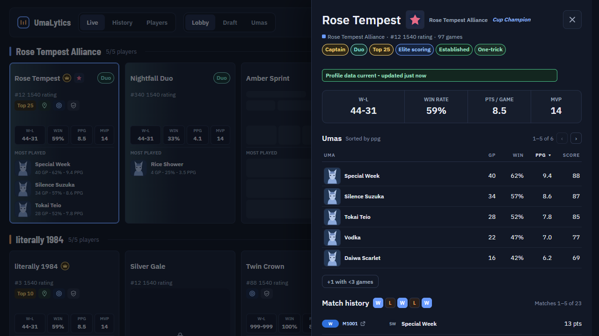
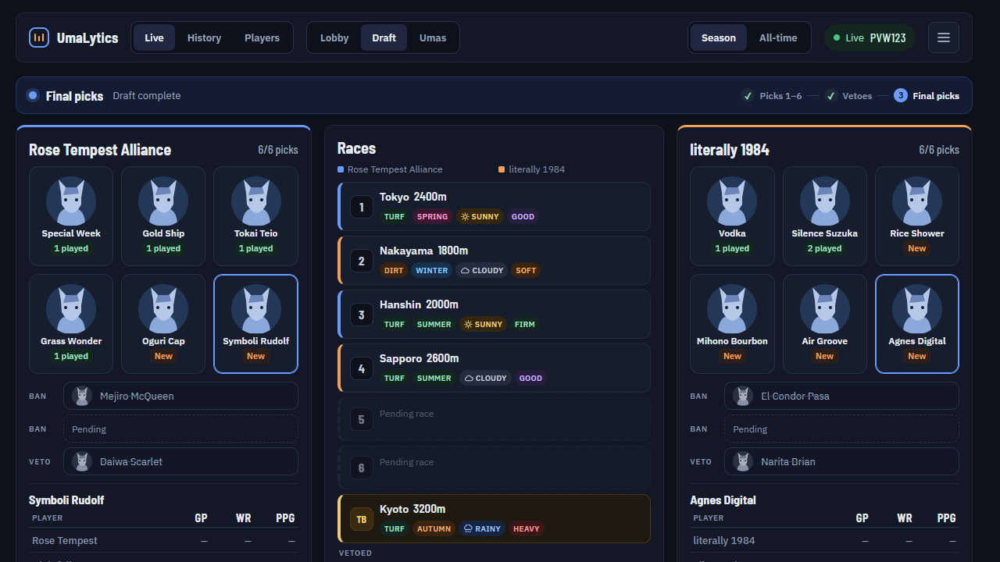
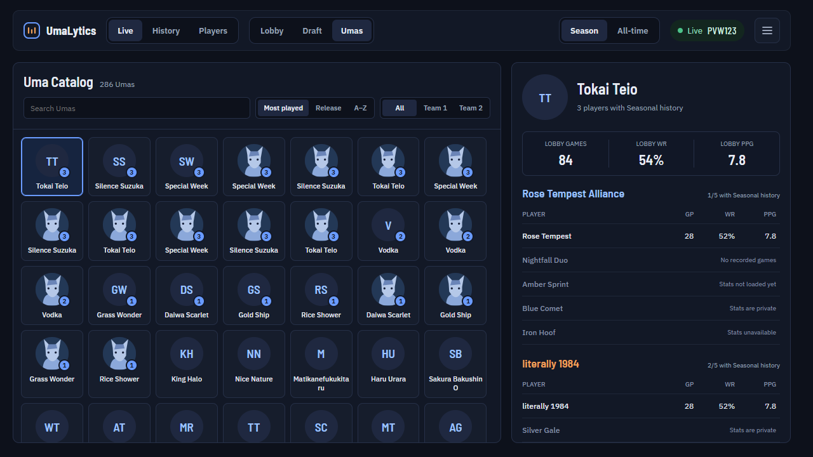

# UmaLytics

[](https://github.com/kjunodev/umalytics/actions/workflows/verify.yml)
[](LICENSE)

A scouting companion for [Uma Drafter](https://drafter.uma.guide): a browser extension that opens a separate window beside your lobby and shows who you are playing, how they perform and what the draft looks like.



## Download

Latest release: v0.5.4. Each release has a Chromium and a Firefox ZIP and a `SHA256SUMS.txt` for checking them.

| Browser | Package |
| --- | --- |
| Chrome, Edge, Brave, Opera GX | [Chromium ZIP](https://github.com/kjunodev/umalytics/releases/tag/v0.5.4), loaded as an unpacked extension |
| Firefox 128 or later, LibreWolf | [Firefox ZIP](https://github.com/kjunodev/umalytics/releases/tag/v0.5.4), loaded as a temporary add-on (unsigned, so load it again after a browser restart) |

Step-by-step instructions: [Install or update UmaLytics](docs/INSTALL.md). Release history: [CHANGELOG](CHANGELOG.md).

## What it does

Enter a room or spectate a draft on Uma Drafter, then click the UmaLytics icon. The header switches between **Live**, **History** and **Players**, and between the **Lobby**, **Draft** and **Umas** scenes. Choose **Season** or **All-time** statistics at any time.

- **Live lobby:** one card per player in team order, with rank and rating, a few badges (for example One-trick, Deep pool, Podium regular, Underrated and Newcomer), record, win rate, points per game, MVP count, their top three Umas and their Uma League team icon. Players who keep their statistics private are shown as private.
- **Player details:** open any card for a drawer with the player's title, a sortable table of their Umas and paged match history. A match code in the history opens that match in History.
- **Draft:** teams, races and picks side by side, with a phase bar, race conditions, bans, vetoes, the tiebreaker map and how much experience each team has on every pick.
- **Umas:** a searchable, sortable catalog of every Uma with the lobby's and each team's experience on it.
- **History:** load a completed match by its code or match-page URL and view it in the same scenes.
- **Players:** search the season leaderboard, or open anyone by profile URL or Discord ID.
- **Also:** Lobby Lock keeps the displayed players fixed, a UI size setting (Small, Default, Large) adapts the window to your display, and the window remembers its size and position in Chromium browsers.





The screenshots come from the repository's preview harness and use fixture data only.

## Privacy

UmaLytics has no backend and no analytics, and nothing is uploaded automatically. It asks Uma Drafter's public API for the stats of the players in your room and keeps recent results, preferences and a small sanitized diagnostic trace in your browser's extension storage. Match history is display-only: it is never used to calculate statistics, badges or the Private state, and statistics a player has hidden stay hidden. The full list of what is requested and stored is in [PRIVACY.md](PRIVACY.md).

## How it works

UmaLytics is a Manifest V3 extension built with TypeScript, React and [WXT](https://wxt.dev). The parts worth looking at:

- **Room detection:** a MAIN-world page hook decodes the site's realtime room events and forwards only whitelisted fields, with a DOM-based fallback. A content script validates the room identity, serializes updates and rejects stale or foreign events.
- **Background service worker:** all API traffic runs through one paced, cancellable queue with rate-limit backoff and a bounded automatic retry. Caches are bounded, and the state that matters (the scouting window, the selected tab, rate-limit recovery, cached responses) survives MV3 service-worker restarts.
- **Data boundary:** match history can be displayed but cannot feed the statistics code. Tests enforce that boundary.
- **Tests:** about 350 Node tests, plus a Playwright layout harness that renders every scene from fixtures and checks geometry across ten viewport sizes and three UI sizes.
- **Delivery:** CI runs the tests, type check and build on every pull request (and the layout harness on pull requests), and releases are published automatically with checksums.

Details: [docs/DEVELOPMENT.md](docs/DEVELOPMENT.md).

## Development

Node 24 and pnpm 9.15.4. No backend, API key or environment file is needed.

```sh
pnpm install --frozen-lockfile
pnpm test
pnpm typecheck
pnpm build:all
pnpm --filter @umalytics/extension preview   # layout harness with fixture data
```

See [docs/DEVELOPMENT.md](docs/DEVELOPMENT.md) for the architecture, the test layout and the release process.

## Feedback

Found a bug or a wrong detection? [Open an issue](https://github.com/kjunodev/umalytics/issues/new?template=bug_report.md) with your browser, the UmaLytics version, what you expected and what happened. If you attach diagnostics from Copy diagnostics, review them first: they can contain room codes and player IDs.

## License

[MIT](LICENSE)
